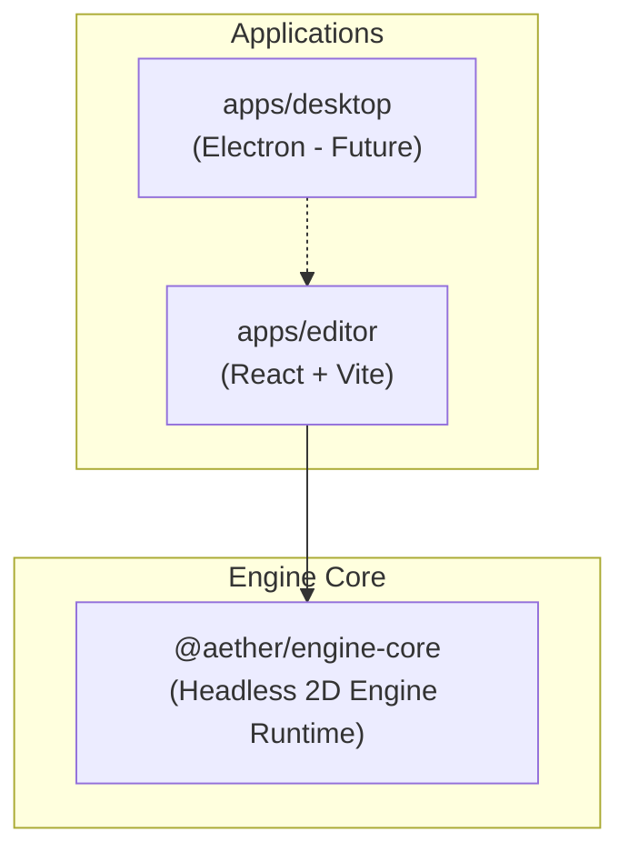
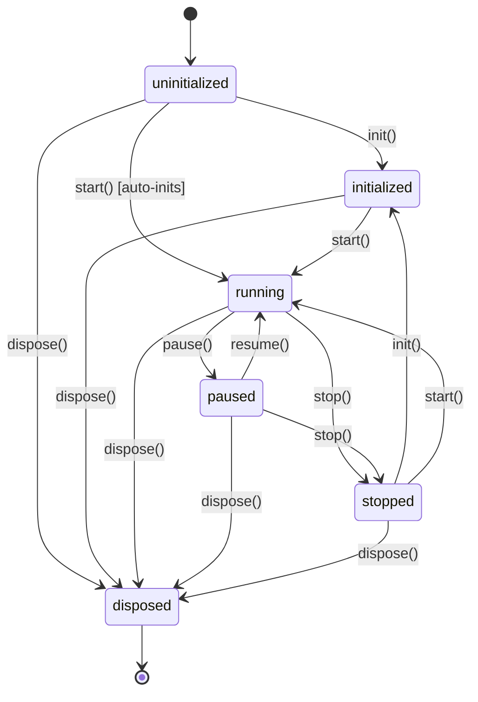

# Aether Engine

> An independent, beginner-friendly 2D game engine built with TypeScript, React, Vite, and WebGL2.

## Vision

Aether Engine is designed from first principles to make 2D game development transparent, approachable, and modular:
- **Clean Core**: A headless, pure TypeScript game engine core with zero UI framework dependencies.
- **Custom WebGL2 Rendering**: Modern hardware-accelerated 2D batch renderer without bloat.
- **Visual Editor**: An intuitive desktop editor crafted with React and Vite.
- **Desktop Distribution**: Electron desktop application shell for native cross-platform deployment.
- **High Test Confidence**: Unit-tested math, scene graph, and game loop using Vitest.

---

## Monorepo Architecture

Aether Engine is organized as an npm workspaces monorepo:

```text
aether-engine/
├── apps/
│   └── editor/             # React + Vite visual editor application
├── packages/
│   └── engine-core/        # Pure TypeScript 2D engine runtime
├── docs/
│   └── ARCHITECTURE.md     # Detailed architecture specifications & diagrams
├── package.json            # Root workspace config & unified scripts
├── tsconfig.base.json      # Shared strict TypeScript configuration
├── vitest.config.ts        # Unified testing configuration
├── .node-version           # Pinned Node.js version (v26.13.0)
├── AGENTS.md               # Guidelines for contributors and AI agents
└── IMPLEMENTATION_LOG.md   # Chronological development journal & troubleshooting log
```



For full details, state machine diagrams, and game loop sequence diagrams, see [**docs/ARCHITECTURE.md**](docs/ARCHITECTURE.md).

### Engine Lifecycle State Machine



---

## Prerequisites

- **Node.js**: `>= 26.13.0`
- **npm**: `>= 11.20.0`
- **Git**: `>= 2.56.0`

---

## Getting Started

### 1. Install Dependencies
```bash
npm install
```

### 2. Run the Editor in Development
```bash
npm run dev
```
Open [http://localhost:3000](http://localhost:3000) in your browser.

### 3. Run Tests
```bash
# Single test run
npm test

# Watch mode
npm run test:watch
```

### 4. Build All Packages
```bash
npm run build
```

### 5. Typecheck
```bash
npm run typecheck
```

---

## Roadmap

- [x] **Milestone 1**: Monorepo Setup, Engine Lifecycle, Game Loop & Input System (npm workspaces, engine-core, React editor, Vitest, strict TypeScript).
- [x] **Milestone 2**: 2D Math Primitives & Transform System (MathUtils, Vector2, Matrix3, Transform2D with dirty-flag hierarchy caching).
- [ ] **Milestone 3**: WebGL2 Batch Renderer (Shaders, textures, quad batching, 2D camera).
- [ ] **Milestone 4**: Scene Graph & Entity Hierarchy.
- [ ] **Milestone 5**: Editor Canvas & Interactive Tooling (Hierarchy, Inspector, Play/Pause).
- [ ] **Milestone 6**: Electron Desktop Application Packaging.
