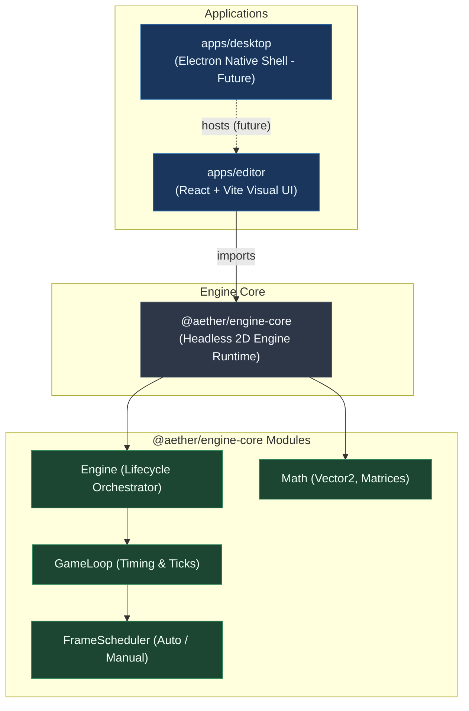
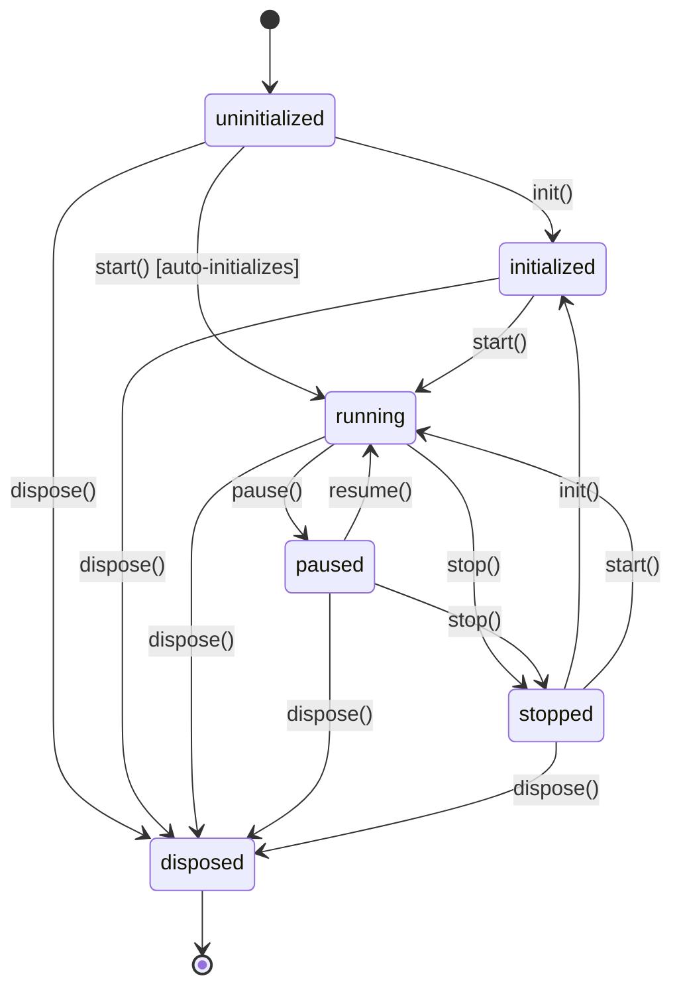
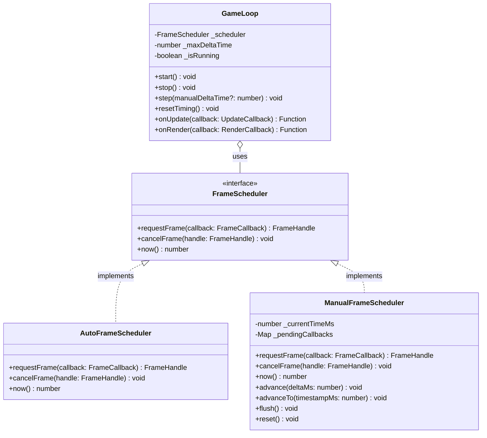

# Aether Engine Architecture

This document provides a comprehensive architectural reference for **Aether Engine**, illustrating package boundaries, the engine lifecycle, frame scheduling abstractions, and the game loop pipeline.

---

## 1. Monorepo Package Boundaries

The engine is architected around a strict separation of concerns. The runtime core is completely headless and platform-agnostic, while higher-level applications consume it.



### Key Isolation Rules:
- **Zero UI in Core**: `packages/engine-core` **must never** import React, DOM elements, or canvas-specific window APIs directly.
- **Pluggable Schedulers**: Time and animation frames are abstracted via `FrameScheduler` so the engine can run inside headless Node.js tests, web browsers, or worker threads.

---

## 2. Engine Lifecycle State Machine

The `Engine` manages high-level lifecycle states and guards against invalid transitions or concurrent loops:



### State Behavior Matrix:

| Current State | `init()` | `start()` | `pause()` | `resume()` | `stop()` | `dispose()` |
| :--- | :--- | :--- | :--- | :--- | :--- | :--- |
| **`uninitialized`** | Transitions to `initialized` | Auto-calls `init()`, transitions to `running` | No-op | No-op | No-op | Transitions to `disposed` |
| **`initialized`** | Safe no-op (idempotent) | Transitions to `running`, starts loop | No-op | No-op | Transitions to `stopped` | Transitions to `disposed` |
| **`running`** | Throws `Error` | Safe no-op (guards against duplicate loops) | Transitions to `paused`, stops loop | Safe no-op | Transitions to `stopped`, stops loop | Stops loop, transitions to `disposed` |
| **`paused`** | Throws `Error` | Calls `resume()`, transitions to `running` | Safe no-op | Resets delta timing, starts loop | Transitions to `stopped` | Stops loop, transitions to `disposed` |
| **`stopped`** | Transitions to `initialized` | Transitions to `running`, starts loop | No-op | No-op | Safe no-op | Transitions to `disposed` |
| **`disposed`** | Throws `Error` | Throws `Error` | Throws `Error` | Throws `Error` | Throws `Error` | Safe no-op (idempotent) |

---

## 3. Game Loop & Frame Execution Pipeline

Each frame generated by the game loop follows a deterministic pipeline:

```mermaid
sequenceDiagram
    autonumber
    participant Scheduler as FrameScheduler<br/>(Auto / Manual)
    participant Loop as GameLoop
    participant Updates as onUpdate Listeners
    participant Renders as onRender Listeners

    Scheduler->>Loop: Frame tick (timestampMs)
    Note over Loop: 1. Calculate raw delta = (timestamp - lastTimestamp) / 1000<br/>2. Clamp delta to maxDeltaTime (e.g. 0.25s)<br/>3. Accumulate totalTime and update FPS
    Loop->>Updates: Dispatch onUpdate(deltaTime)
    Note over Updates: Physics, input, logic, transformations
    Loop->>Renders: Dispatch onRender(interpolation)
    Note over Renders: Drawing, sprite batching, UI canvas
    alt isRunning == true
        Loop->>Scheduler: requestFrame(nextTick)
    else isRunning == false
        Note over Loop: Scheduling halted
    end
```

---

## 4. Frame Scheduling Abstraction

To ensure high test confidence without browser dependency, the loop relies on the `FrameScheduler` contract:



- **`AutoFrameScheduler`**: Used in runtime applications. Automatically uses browser `requestAnimationFrame` when present, or `setTimeout(..., 16)` and `performance.now()` in headless Node.js.
- **`ManualFrameScheduler`**: Used in unit tests. Steps simulated time forward instantly with `advance(ms)`, flushing frame callbacks synchronously for 100% deterministic tests.
